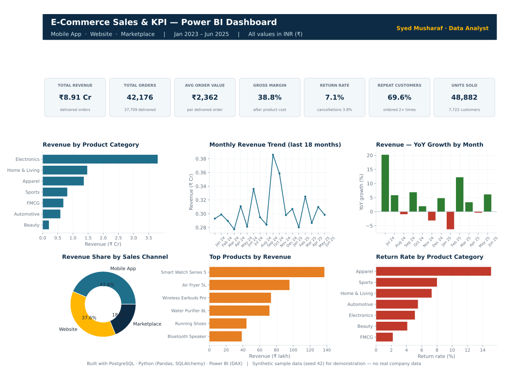
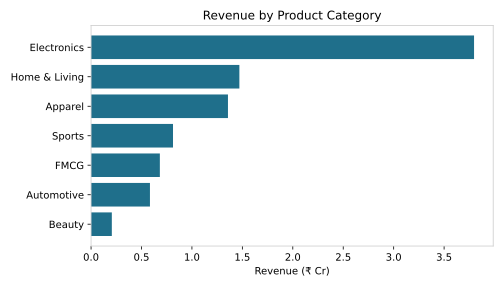
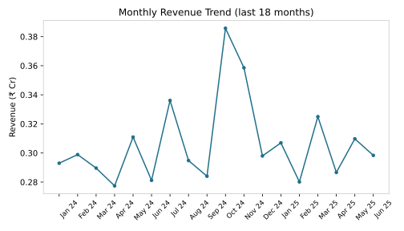
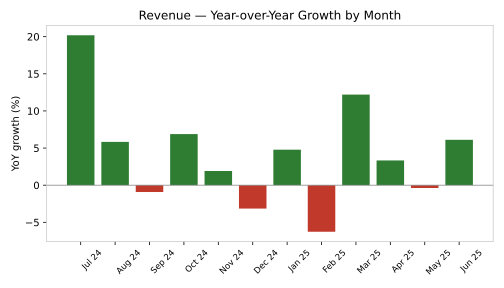
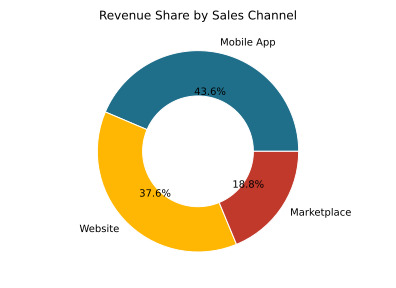
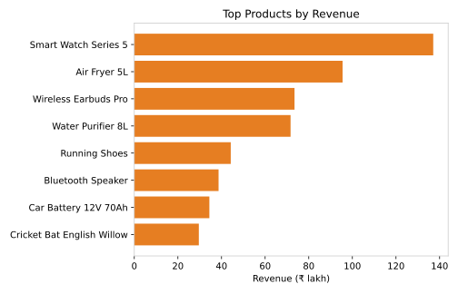
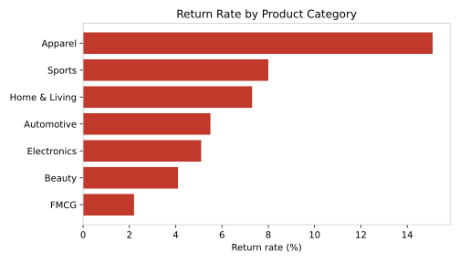

# E-Commerce Sales & KPI Dashboard


-336791?logo=postgresql&logoColor=white)


**SQL · Python (Pandas) · Power BI** — sales and KPI analytics for an Indian online
retailer (Mobile App · Website · Marketplace), Jan 2023 – Jun 2025.
All values in **Indian Rupees (₹)**. Every column uses a clear, friendly name —
see the [data dictionary](data/data_dictionary.md).

## 📊 Power BI Dashboard



| KPI | Value | | KPI | Value |
|---|---|---|---|---|
| **Total Revenue** | **₹8.91 Cr** | | Gross Margin | 38.8% |
| **Total Orders** | **42,176** | | Return Rate | 7.1% |
| **Average Order Value** | **₹2,362** | | Repeat Customers | 69.6% |
| **Units Sold** | **48,882** | | Active Customers | 7,722 |

**Dashboard pages:** 1) Executive Overview — KPI cards, channel donut, category
revenue, monthly trend · 2) Growth & Trends — WoW / MoM / YoY comparisons (LAG) ·
3) Category & Product Deep-Dive — margins, return rates, top products ·
4) Customers & Regions — segments, regions, top cities.

**Build it in Power BI Desktop (~20 min):**
[Build guide](dashboard/powerbi_build_guide.md) ·
[DAX measures](dashboard/dax_measures.dax) ·
[Power Query load code](dashboard/power_query_m.txt)

**Interactive version (browser):**
[`dashboard/dashboard.html`](dashboard/dashboard.html)

## Contents
- [Business questions](#business-questions)
- [Key results](#key-results-jan-2023--jun-2025-sample-data)
- [Growth — LAG comparisons](#growth--lag-comparisons-weekly--monthly--yearly)
- [Insights](#insights)
- [Top products](#top-products-by-revenue)
- [Charts](#charts)
- [Repository structure](#repository-structure)
- [How to run](#how-to-run)

## Business questions
- Which sales channel and product categories drive the most revenue?
- Where is margin being made — and where do returns eat it away?
- How much revenue comes from loyal customers vs one-time buyers?
- Which regions and cities are the strongest markets?
- How are sales growing — week over week, month over month, year over year?

## Key results (Jan 2023 – Jun 2025, sample data)

| KPI | Value |
|---|---|
| Total revenue (delivered orders) | ₹8,90,87,408 |
| Total orders | 42,176 |
| Delivered orders | 37,709 |
| Total units sold | 48,882 |
| Average order value | ₹2,362 |
| Gross margin | 38.8% |
| Return rate | 7.1% |
| Cancellation rate | 3.8% |
| Repeat customer rate | 69.6% |
| Active customers | 7,722 |
| Average discount | 11.0% |
| Average delivery time | 4.5 days |

Dataset: 42,176 orders · 9,000 customers · 30 products · 3 sales channels · 4 regions.
Star schema: the fact table references the product and customer dimensions
(delivery city/region come from the customer dimension).
Revenue counts **delivered** orders only; returns and cancellations are measured as rates.

## Growth — LAG comparisons (weekly · monthly · yearly)
Computed with the SQL **`LAG()` window function** (`sql/02_kpi_queries.sql`,
queries 9–11), mirrored in Python with `shift()` and in Power BI with DAX
time-intelligence measures:

- **Weekly:** week-over-week (WoW) revenue growth % → `outputs/weekly_trend.csv`
- **Monthly:** month-over-month (MoM) and year-over-year (YoY) growth % → `outputs/monthly_trend.csv`
- **Yearly:** year-over-year growth % → `outputs/yearly_summary.csv` (2025 is Jan–Jun only, flagged partial)

Headline: 2024 revenue grew **+9.3% YoY** over 2023,
and Jun 2025 is **+6.1% vs Jun 2024**.
The monthly trend also shows the **Diwali festival spike** every Oct–Nov.

## Insights
- **Mobile App is the #1 channel:** 43.6% of revenue
  (₹3.88 Cr). Marketplace has the lowest average order
  value (₹2,211) — it wins orders with the deepest discounts.
- **Electronics drives revenue:** ₹3.80 Cr — but
  **Apparel is the margin-and-returns story:** 49.9% gross margin
  with a 15.1% return rate, the highest of any category.
- **Loyal customers carry the business:** 2,871 loyal buyers
  (5+ orders) generate 75.1% of revenue, while one-time buyers
  are 30% of customers but only 6.0% of revenue.

## Top products by revenue

| Product | Category | Units Sold | Revenue | Return Rate |
|---|---|---|---|---|
| Smart Watch Series 5 | Electronics | 1,925 | ₹1,37,08,395 | 4.9% |
| Air Fryer 5L | Electronics | 1,655 | ₹95,51,412 | 5.0% |
| Wireless Earbuds Pro | Electronics | 2,757 | ₹73,47,564 | 4.7% |
| Water Purifier 8L | Home & Living | 806 | ₹71,66,496 | 8.4% |
| Running Shoes | Apparel | 1,993 | ₹44,23,861 | 15.5% |

## Charts







## Repository structure
```
data/        dim_products, dim_customers, fact_orders (CSV) + data dictionary
sql/         01_schema_postgresql.sql, 02_kpi_queries.sql (11 KPI queries incl. LAG growth)
python/      generate_sample_data.py, etl_pipeline.py, kpi_analysis.py
dashboard/   dashboard.html + index.html + build_dashboard.py (browser dashboard),
             build_dashboard_image.py (README dashboard image),
             powerbi_build_guide.md, power_query_m.txt, dax_measures.dax (Power BI pack)
outputs/     KPI tables with friendly column names: summary, by channel, by category,
             by region, top products, customer segments, weekly/monthly/yearly trends
images/      power_bi_dashboard.svg (full dashboard) + individual charts (SVG)
```

## How to run
```bash
pip install -r requirements.txt
python python/generate_sample_data.py     # creates the sample dataset (seed 42)
python python/etl_pipeline.py             # validate -> transform -> load (SQLite demo DB)
python python/kpi_analysis.py             # KPI tables + charts + growth comparisons
python dashboard/build_dashboard.py       # builds dashboard/dashboard.html + index.html
python dashboard/build_dashboard_image.py # builds images/power_bi_dashboard.svg
```
For production, the same schema and queries run on PostgreSQL
(`sql/01_schema_postgresql.sql`); the ETL loads to SQLite locally so the full
pipeline runs anywhere with zero setup.

## Tools & skills demonstrated
PostgreSQL (joins, aggregation, `LAG()` window function for WoW/MoM/YoY growth) ·
Python (Pandas, SQLAlchemy, Matplotlib) · Power BI & DAX (incl. time-intelligence
measures) · E-commerce KPI design (Revenue, AOV, Gross Margin, Return Rate,
Repeat Customer Rate) · Customer segmentation · Star-schema modelling ·
Data validation & ETL design

## Note on data
The dataset is **synthetic sample data** generated by
`python/generate_sample_data.py`, modelled on the structure of a real e-commerce
sales analytics project (orders, customers, channels, returns, festival-season
spikes). It contains no real company data.

---
**Author:** Syed Musharaf — Data Analyst · [GitHub](https://github.com/syedmusharaf0) · MIT License
